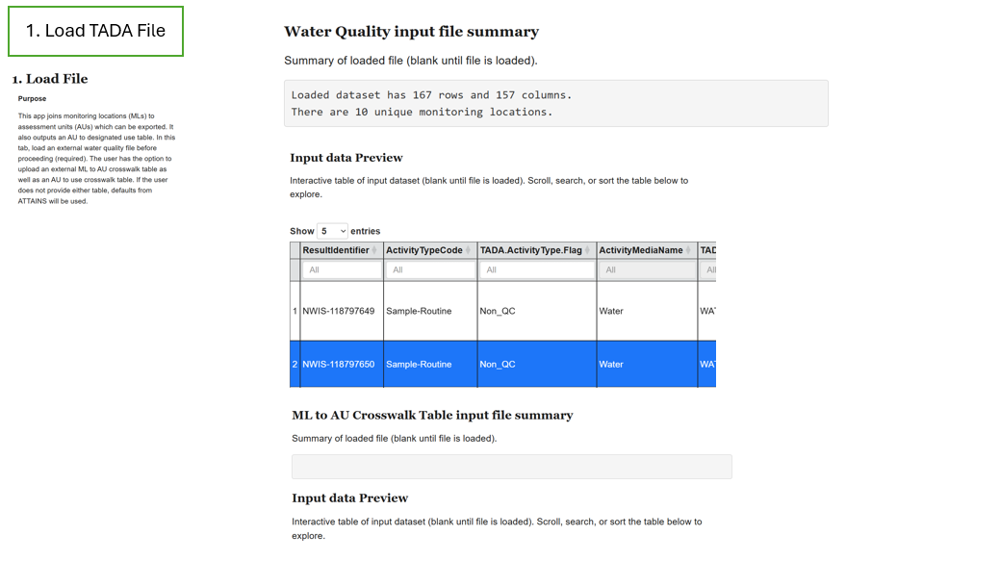
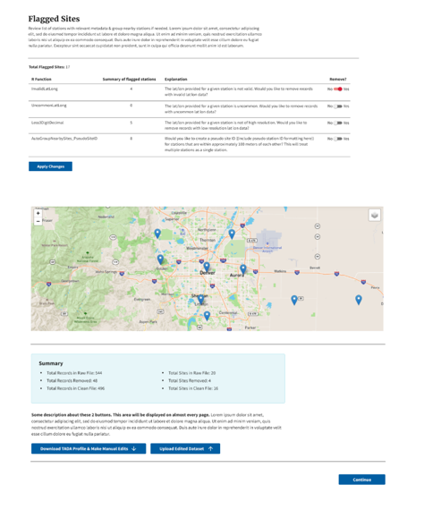
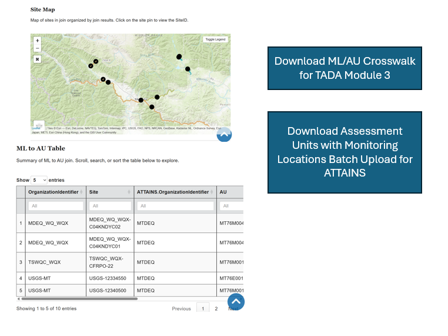
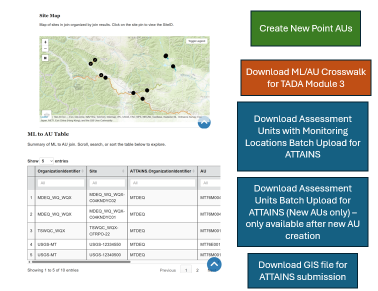
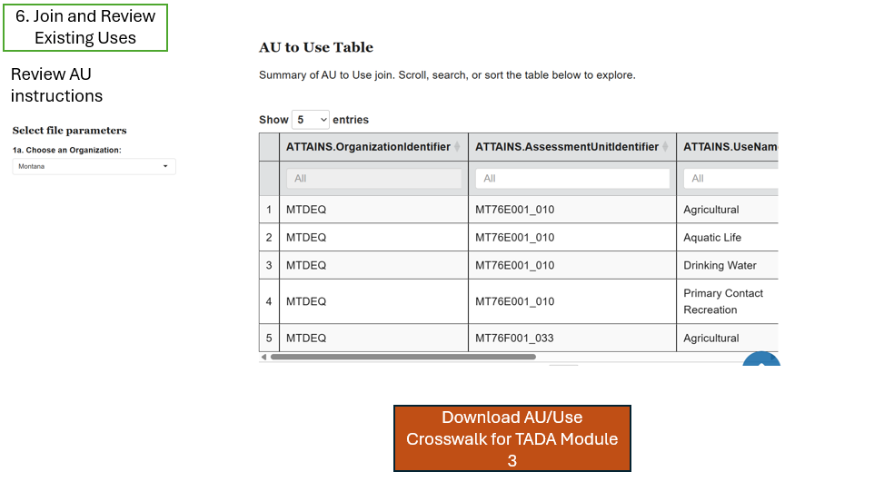
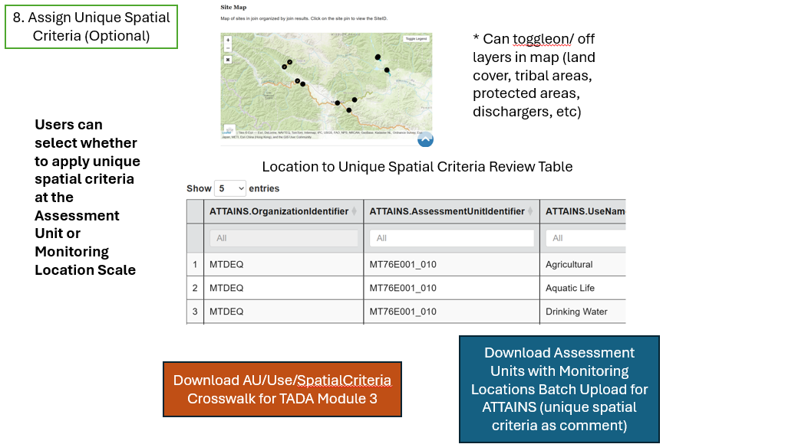
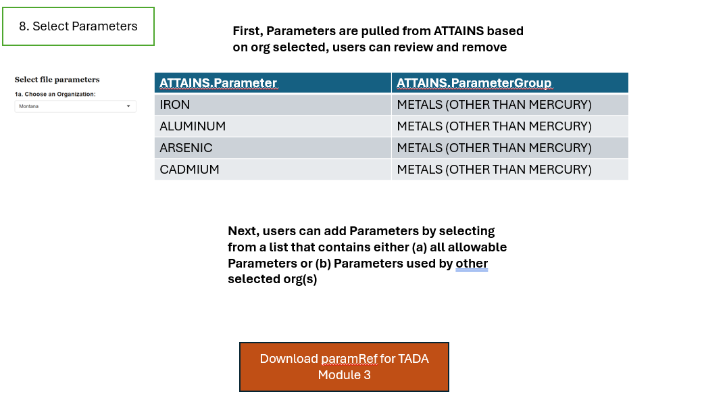
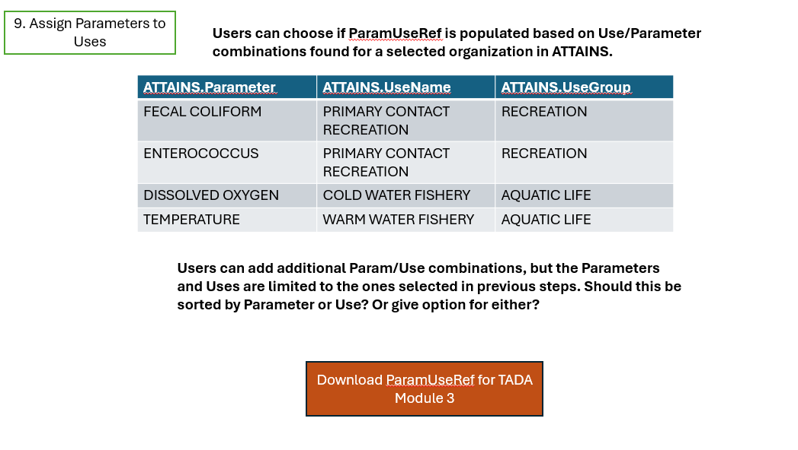
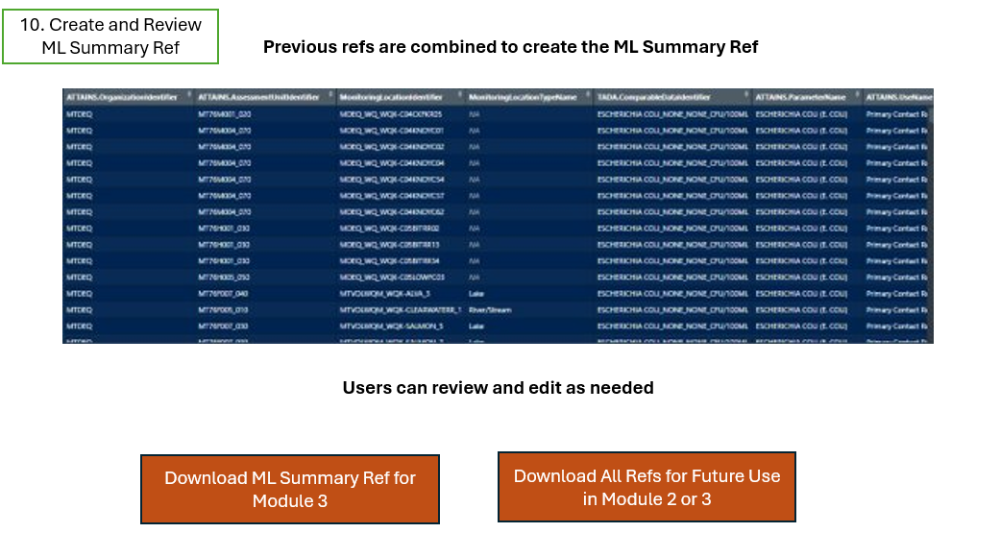

```{r setup, include = F}
library(knitr)

knitr::opts_chunk$set(
  echo = TRUE,
  warning = FALSE,
  message = FALSE,
  eval = T,
  dev.args = list(bg = "transparent")
)
```

## TADA Module 2 Use Cases

This vignette focuses on the following TADA module 2 use cases:

1)  State/Existing ATTAINS Tribe

2)  New ATTAINS Tribe

3)  State With Existing AU/ML/Use Crosswalks - formatting help only

## 

## 1) State/Existing ATTAINS Tribe

1.  Load TADA File – loads Mod 1 output file containing all data for
    assessments .

-   Displays a preview of the WQP input file and a summary

-   No other crosswalks/tables are imported at this stages



```{r load.tribal}

# load TADA dataset (cleaned/harmonized/filtered TADA df from TADAShiny)
# modified a couple of rows so that they will show up as flagged coordinates
mod1.tribal <- Data_TribalNations_Harmonized |>
  dplyr::filter(OrganizationFormalName == "Fond du Lac Band of Chippewa (MN)") |>
  dplyr::mutate(TADA.LatitudeMeasure =
                  dplyr::case_when(MonitoringLocationIdentifier == "FONDULAC_WQX-101" ~ 50.00,
                                   MonitoringLocationIdentifier == "FONDULAC_WQX-119" ~ 46.6,
                                   .default = TADA.LatitudeMeasure))

```

2.  Flag and Review Sites - users can view flagged coordinates and
    nearby sites on a map

-   Users view a map that contains both flagged coordinates and nearby
    sites (they choose to toggle between the two layers).

-   There is a table below where they can edit or choose to
    include/exclude a monitoring location.

    -   Should there be separate tables for (1) flagged coordinates and

        (2) nearby sites or should it be a combined table? (Whichever is
            most user friendly)

-   If users select to exclude any monitoring locations from further
    analysis in this tab, they need to be filtered out of the working
    data set before moving to the next tab

-   Similar to TADAShiny, two versions of the TADA df need to be
    maintained throughout the app. One reflects the users choices to
    exclude/filter and is what is passed to the next tab ("Final
    Dataset"). The other either adds (or edits the existing) TADA.Remove
    and TADA.RemovalReason columns ("Working Dataset").

    -   TADA.Remove should be set to TRUE if a user opts to exclude the
        MonitoringLocation on any tab, otherwise it remains FALSE.

    -   TADA.RemovalReason should add a flag/comment as reflecting the
        tab it was removed on. For this tab it should be something like
        "

        \*\*\* There are currently some issues with the Hi resolution
        NHD web services. Our recommendation is to set the catchment
        param to FALSE for both TADA_FindNearbySites and
        TADA_SitesToggleMap for testing during Shiny development. \*\*\*



```{r}
mod1.flagsites <- mod1.tribal |>
  TADA_FlagCoordinates() |>
  TADA_FindNearbySites(catchment = FALSE)

tribal.review.sites <- TADA_SitesToggleMap(mod1.flagsites, catchment = FALSE)

TADA_FlaggedSitesMap(mod1.flagsites)

tribal.review.sites

# combined review table (this could be split into two tables, one for flagged coordinates, one for nearby sites)
# if a combined table - should the table filter to include only the results from the layer selected?
DT::datatable(mod1.flagsites |>
                dplyr::select(TADA.MonitoringLocationName,
                              TADA.MonitoringLocationIdentifier,
                              MonitoringLocationIdentifier,
                              OrganizationFormalName,
                              TADA.LatitudeMeasure,
                              TADA.LongitudeMeasure,
                              TADA.SuspectCoordinates.Flag,
                              TADA.NearbySiteGroup) |>
                dplyr::filter(!is.na(TADA.NearbySiteGroup) |
                              TADA.SuspectCoordinates.Flag != "Pass") |>
                dplyr::mutate(IncludeForAnalysis = "Include") |>
                dplyr::distinct())
# this table should be editable so users can choose to exclude selected monitoring locations, the excluded locations need to be filtered out from the data set moving forward

# this should be set up similar to TADA_RemovalReason in TADAShiny, where a copy of the original df with all rows is maintained with an appended removal reason column.

# for example, here a few excluded sites are added to the "Final Dataset" df
# I have not mocked up the "Working Dataset" which needs the removal reason added
mod1.flagsites <- mod1.flagsites |>
  dplyr::mutate(IncludeForAnalysis = "Include") |>
  dplyr::mutate(IncludeForAnalysis = ifelse(MonitoringLocationIdentifier %in% c("FONDULAC_WQX-122", "FONDULAC_WQX-122I", "FONDULAC_WQX-122F", "FONDULAC_WQX-122M", "FONDULAC_WQX-122J"), "Exclude", IncludeOrExclude)) |>
  dplyr::filter(IncludeOrExclude != "Exclude")

# if sites/monitoring locations are excluded, but other sites are maintained in the nearby site group, the TADA.MonitoringLocationIdentifier should be updated to contained only the retained MonitoringLocationIdentifiers

# if the user wants to maintain a nearby grouped site as its own unique location, they will need to edit TADA.MonitoringLocationIdentifier so it has its own unique identifer (ideally, this would its own origianl MonitoringLocationIdentifier - maybe there is a way to help facilitate this easily?)

```

3.  Join and Review AUs - join WQP monitoring locations with ATTAINS
    Assessment Units

    On this tab users have the option of uploading a monitoring
    location/assessment unit crosswalk if they store that information
    outside of ATTAINS.

    They can select an Organization in a dropdown menu to choose the
    subset of ATTAINS geometry which should be matched with their WQP
    data or can use "All" which will match monitoring locations with AUs
    from any organization.

    When they join the AUs/MLs, the function looks first to the user
    supplied crosswalk, then any matches record in ATTAINS, then uses
    geospatial joins for any unmatched monitoring locations.

    There is also an editable data table where uses can choose to
    exclude monitoring locations from further analysis or change the AU
    they are assigned to. The structure of the table in the existing
    version of TADAShinyJoinToAU is correct.

    Any changes made by the user should be carried over to the next tab.
    If the user has chosen to exclude a monitoring location it should be
    filter out of the Final Dataset and TADA.Remove and
    TADA.RemovalReason should be updated in the Working Dataset.

    

    ```{r}
    tribal.aus <- TADA_CreateAUMLCrosswalk(mod1.flagsites)

    TADA_ViewATTAINS(tribal.aus)

    # from this point on the TADA_with_ATTAINS df is the one to continue moving forward with
    tribal.au.matches <- tribal.aus$TADA_with_ATTAINS

    # df that should be downloaded for ATTAINS batch upload

    # df that should be downloaded for Mod 3 crosswalk
    ```

4.  Create New Point AUs (optional) - for tribal use cases, users may
    want to create new point AUs for assessment, this is currently
    limited to point AUs only

    

    ```{r}

    tribal.no.aus <- tribal.au.matches |>
      dplyr::filter(is.na(ATTAINS.AssessmentUnitIdentifier)) |>
      sf::st_drop_geometry()

    tribal.new.aus <- TADA_CreatePointAUs(tribal.no.aus, tada_df = TRUE, create_geo = TRUE)

    TADA_ViewNewAUs(tribal.new.aus$tada_df)

    # bind rows of new AUs to existing ones
    tribal.all.aus <- tribal.au.matches |>
      dplyr::filter(!is.na(ATTAINS.AssessmentUnitIdentifier)) |>
      dplyr::bind_rows(tribal.new.aus$tada_df)

    # create crosswalk for joining uses
    tribal.crosswalk.for.uses <- tribal.all.aus |>
      dplyr::select(TADA.MonitoringLocationIdentifier, TADA.MonitoringLocationIdentifier, TADA.MonitoringLocationTypeName, ATTAINS.AssessmentUnitIdentifier, ATTAINS.AssessmentUnitName, ATTAINS.WaterType, ATTAINS.OrganizationIdentifier) |>
      dplyr::distinct() |>
      sf::st_drop_geometry()
    ```

5.  Join and Review Existing Uses

    

    ```{r}


    tribal.UseAURef <- TADA_AssignUsesToAU(
      tribal.all.aus,
      AUMLRef = tribal.crosswalk.for.uses,
      org_id = "All",
      api_key = EPATADA:::.setEQKey()
    )

    ```

6.  Assign New Uses to Existing or New AUs - HAVE NOT ADDED DETAILS YET
    FROM THIS POINT FORWARD

    Need to add a button so users have the option of assigning new uses
    by water type. The **`TADA_AssignUsesToWaterType`** function imports
    combinations of water types and use names associated with the
    specified organization from ATTAINS. It automatically assigns uses
    to new assessment units based on their water type.

    Users should also be able to add new rows manually to assign
    additional uses. The ATTAINS.AssessmentUnitIdentifier column should,
    if possible, have a dropdown menu that allows users to select from
    the existing ATTAINS.AssessmentUnitIdentifier in their data set.
    ATTAINS.OrganizationIdentifier should autofill. The ATTAINS.UseName
    choices can be limited to a selected organization or include all use
    names allowable in ATTAINS.

    ```{r}

    MT.UseAURef_with_WaterUseRef <-
      TADA_AssignUsesToAU(
        MT.AUMLRef$TADA_with_ATTAINS,
        waterUseRef = TADA_AssignUsesToWaterType(org_id = "MTDEQ"),
        AUMLRef = Final.MT.AUMLRef,
        org_id = "MTDEQ",
        api_key = api_key
      )
    ```

7.  Assign Unique Spatial Criteria

    There are two components to this tab. The first is to (optionally)
    run **TADA_SaltFreshIndicator** to populate the SaltFreshIndicator
    column. Users should be able to skip this as non-coastal states or
    tribes may not need this functionality. They can edit the values in
    the SaltFreshIndicator column.

    The second is to allow users to manually edit the
    UniqueSpatialCriteria column. They can enter character strings of
    their choice here. It might be helpful to include a section where
    they enter the values they wish to use in the UniqueSpatialCriteria
    column which would then populate a dropdown menu to prevent data
    entry errors.

    

    ```{r}

    ```

8.  Select Parameters

    First users are review Parameters pulled from ATTAINS based on the
    selected organization and remove any they don't wish to include.
    Next, they can select additional organization(s) or the entirety of
    the ATTAINS parameter domain values and add additional parameters
    that they want to include in their analysis.

    The **rExpertQuery** function **rExpertQuery::EQ_DomainValues()**
    can be used to assist with this. An example is included in the code
    chunk below.

    

    ```{r}

    ```

9.  Assign Parameters to Uses

    

10. Create and Review ML SummaryRef

    

```{r watertypetable}
TADA_TableExport(MT.UseAURef_with_WaterUseRef)
```

Users also have the option to manually assign use names to new AUs if
they prefer not to use the TADA_AssignUsesToWaterType function. This
approach allows for greater flexibility and customization when
integrating new AUs into existing frameworks.

```{r assign.use.to.new.AU.manual}
MT.UseAURef_manual <- MT.UseAURef |>
  dplyr::left_join(
    data.frame(
      ATTAINS.UseName = c("Aquatic Life", "Drinking Water"),
      ATTAINS.AssessmentUnitIdentifier = c("NEW:EX_MDEQ_WQ_WQX", "NEW:EX_MDEQ_WQ_WQX")
    ),
    by = ("ATTAINS.AssessmentUnitIdentifier")
  ) |>
  dplyr::mutate(ATTAINS.UseName = dplyr::coalesce(ATTAINS.UseName.x, ATTAINS.UseName.y)) |>
  dplyr::select(-ATTAINS.UseName.x, -ATTAINS.UseName.y)

TADA_TableExport(MT.UseAURef_manual)
```

# Summary

In conclusion, this example TADA Module 2 workflow significantly
enhances the ability to maintain up-to-date information on WQP
Monitoring Locations and the uses being assessed at various ATTAINS
Assessment Units. By systematically guiding users through the creation
of crosswalks, map reviews, data submission, and use assignments, this
workflow supports efficient data management and improves
reproducibility.
