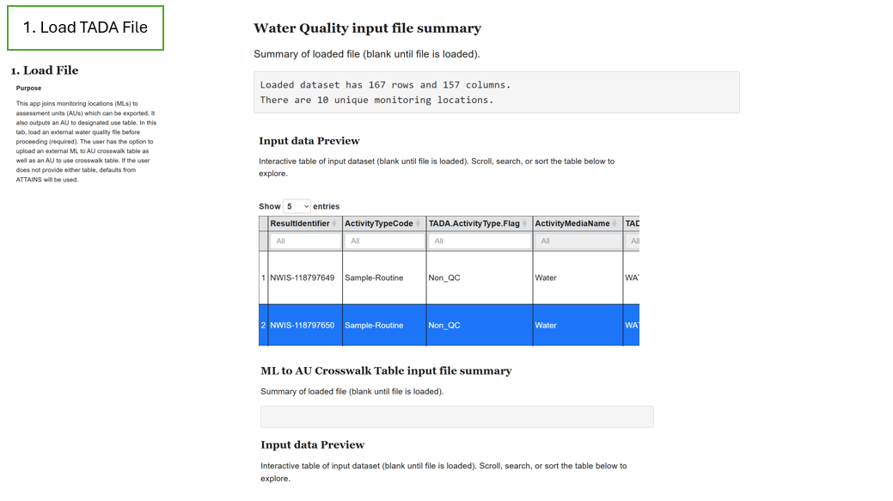
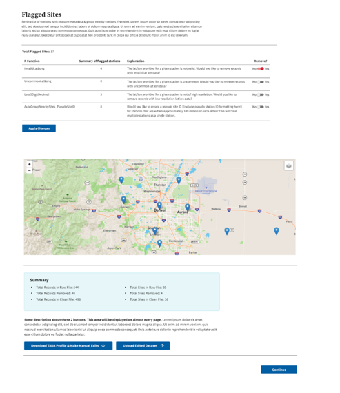
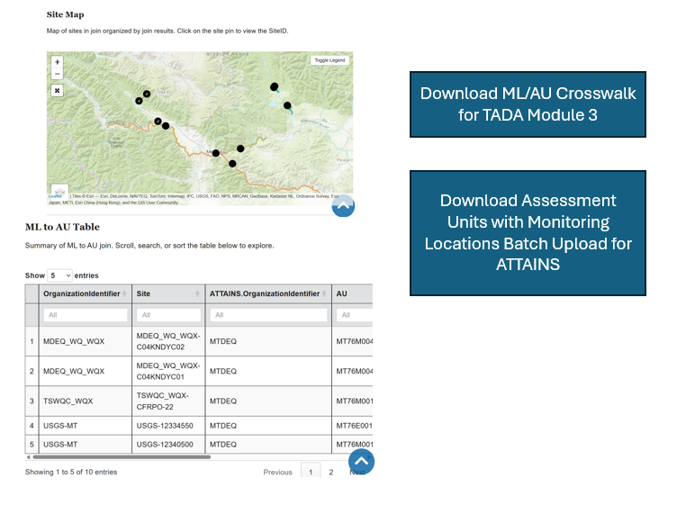
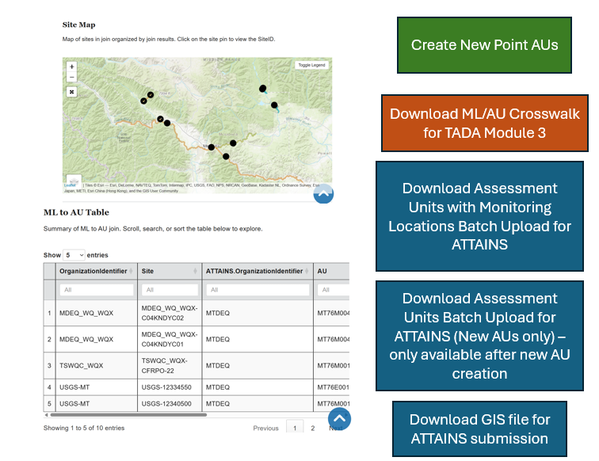
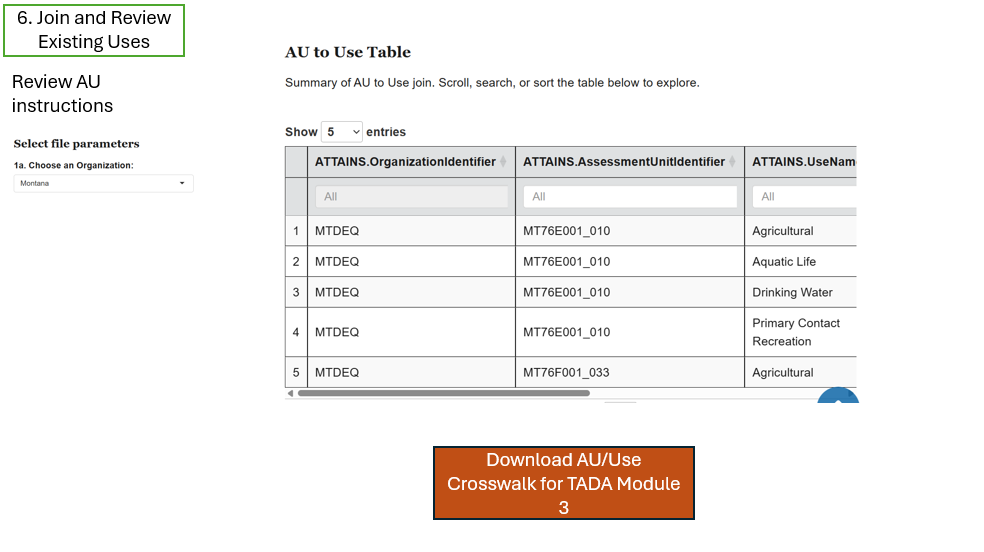
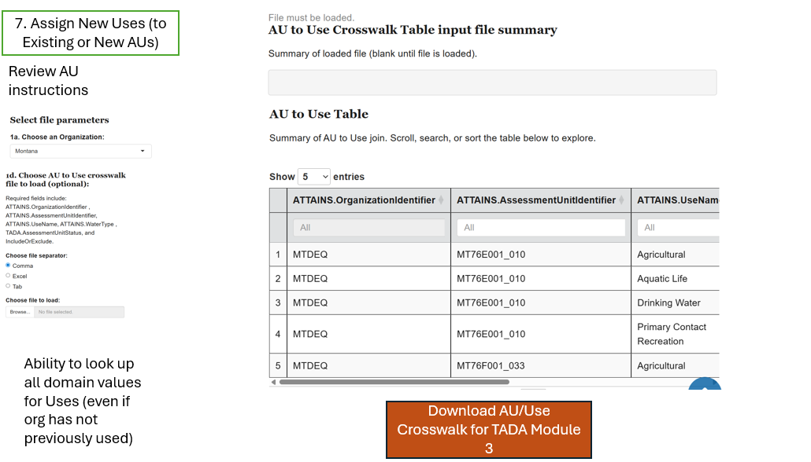
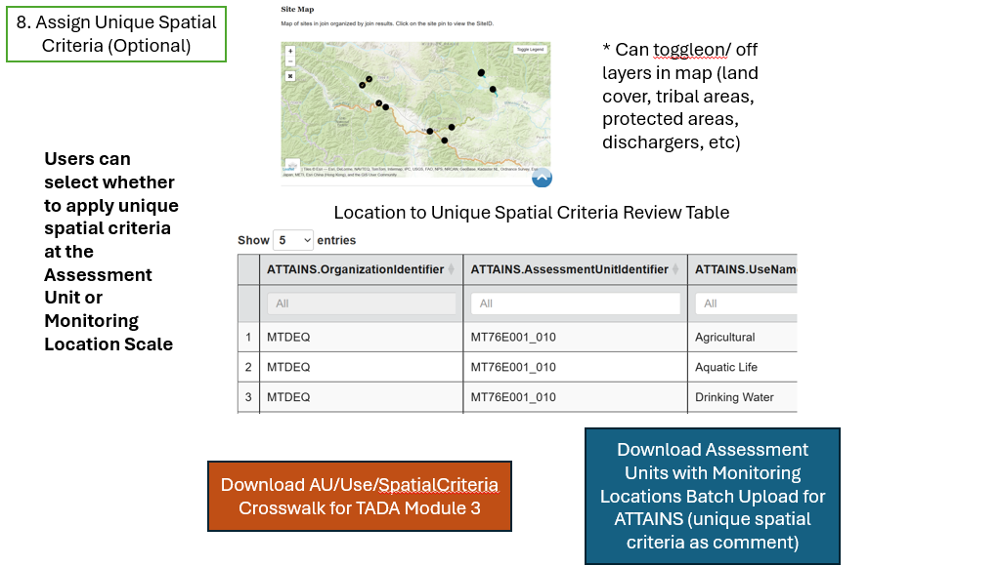
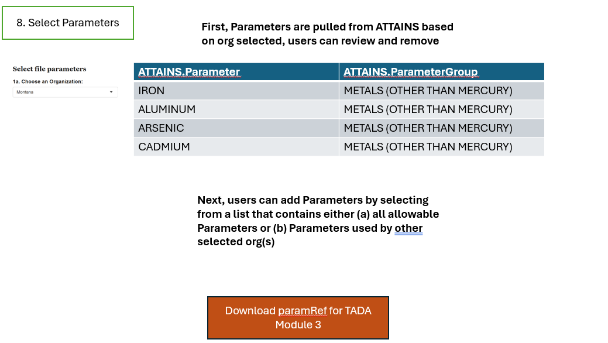
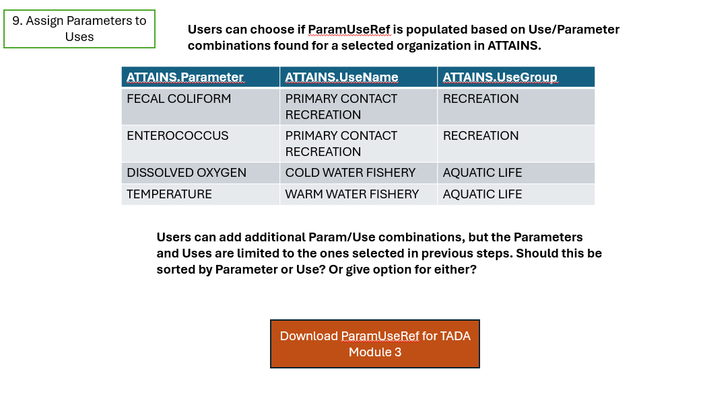
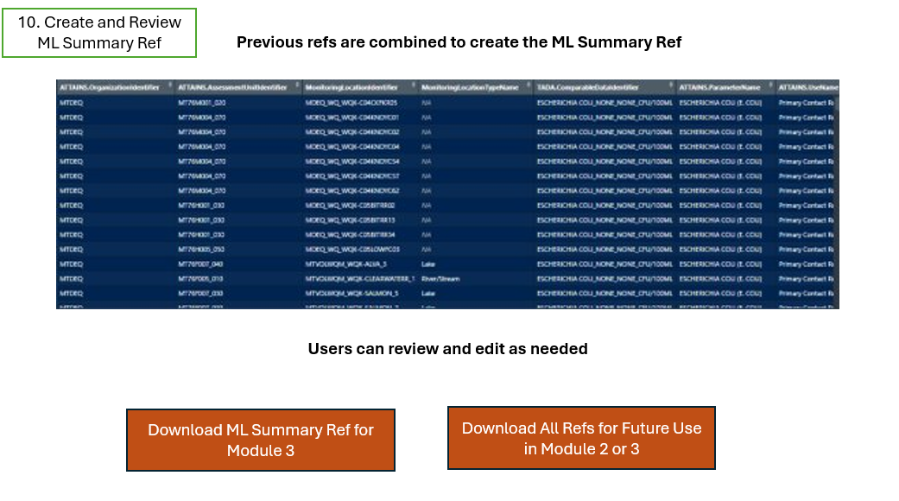

```{r setup, include = F}
library(knitr)

knitr::opts_chunk$set(
  echo = TRUE,
  warning = FALSE,
  message = FALSE,
  eval = T,
  dev.args = list(bg = "transparent")
)
```

# Overview and Setup

**Welcome!**

Thank you for your interest in Tools for Automated Data Analysis (TADA).
TADA is an open-source tool set built in the R programming language.
This [RMarkdown](https://yihui.org/rmarkdown/) document walks users
through how to download the TADA R package from GitHub, access and
parameterize several important functions, and create basic
visualizations with a sample data set.

**Note:** TADA is still under development. New functionality is added
weekly, and sometimes we need to make bug fixes in response to tester
and user feedback. We appreciate your feedback, patience, and interest
in these helpful tools.

If you are interested in contributing to TADA development, more
information is available at:

[Contributing](https://usepa.github.io/EPATADA/articles/CONTRIBUTING.html)

We welcome collaboration with external partners.

## TADA Module 2 Use Cases

This vignette focuses on the following TADA module 2 use cases:

1)  New ATTAINS Tribe

2)  State/Existing ATTAINS Tribe

3)  State With Existing AU/ML/Use Crosswalks - formatting help only

## 1) New ATTAINS Tribe

1.  Load TADA File – loads Mod 1 output file containing all data for
    assessments .

-   Displays a preview of the WQP input file and a summary

-   No other crosswalks/tables are imported at this stages

1.  

```{r load.tribal}

mod1.tribal <- Data_TribalNations_Harmonized

```

2.  Flag and Review Sites - users can view flagged coordinates and
    nearby sites on a map

-   Users view a map that contains both flagged coordinates and nearby
    sites (they choose to toggle between the two layers).

-   There is a table below where they can edit or choose to
    include/exclude a monitoring location.

    -   Should there be separate tables for (1) flagged coordinates and
        (2) nearby sites or should it be a combined table? (Whichever is
        most user friendly)

-   If users select to exclude any monitoring locations from further
    analysis in this tab, they need to be filtered out of the working
    data set before moving to the next tab



```{r}
mod1.flagsites <- mod1.tribal |>
  TADA_FlagCoordinates() |>
  TADA_FindNearbySites(catchment = FALSE)

tribal.review.sites <- TADA_SitesToggleMap(mod1.flagsites, catchment = FALSE)

tribal.review.sites

# combined review table (this could be split into two tables, one for flagged coordinates, one for nearby sites)
DT::datatable(mod1.flagsites |>
                dplyr::select(TADA.MonitoringLocationName,
                              TADA.MonitoringLocationIdentifier,
                              MonitoringLocationIdentifier,
                              OrganizationFormalName,
                              TADA.LatitudeMeasure,
                              TADA.LongitudeMeasure,
                              TADA.SuspectCoordinates.Flag,
                              TADA.NearbySiteGroup) |>
                dplyr::filter(!is.na(TADA.NearbySiteGroup) |
                              TADA.SuspectCoordinates.Flag != "Pass") |>
                dplyr::mutate(IncludeForAnalysis = "Include") |>
                dplyr::distinct())
# this table should be editable so users can choose to exclude selected monitoring locations, the excluded locations need to be filtered out from the data set moving forward

# this should be set up similar to TADA_RemovalReason in TADAShiny, where a copy of the original df with all rows is maintained with an appended removal reason column.

# for example, here are a few excluded sites added to the df
mod1.flagsites <- mod1.flagsites |>
  dplyr::mutate(IncludeForAnalysis = "Include") |>
  dplyr::mutate(IncludeForAnalysis = ifelse(MonitoringLocationIdentifier %in% c("FONDULAC_WQX-122", "FONDULAC_WQX-122I", "FONDULAC_WQX-122F", "FONDULAC_WQX-122M", "FONDULAC_WQX-122J"), "Exclude", IncludeForAnalysis)) |>
  dplyr::filter(IncludeForAnalysis != "Exclude")
```

3.  Join and Review AUs - join WQP monitoring locations with ATTAINS
    Assessment Units

    On this tab users have the option of uploading a monitoring
    location/assessment unit crosswalk if they store that information
    outside of ATTAINS.

    They can select an Organization in a dropdown menu to choose the
    subset of ATTAINS geometry which should be matched with their WQP
    data or can use "All" which will match monitoring locations with AUs
    from any organization.

    When they join the AUs/MLs, the function looks first to the user
    supplied crosswalk, then any matches record in ATTAINS, then uses
    geospatial joins for any unmatched monitoring locations.

    There is also an editable data table where uses can choose to
    exclude monitoring locations from further analysis or change the AU
    they are assigned to. The structure of the table in the existing
    version of TADAShinyJoinToAU is correct.

    Any changes made by the user should be carried over to the next tab.

    

    ```{r}
    tribal.aus <- TADA_CreateAUMLCrosswalk(mod1.flagsites)

    TADA_ViewATTAINS(tribal.aus)

    # from this point forward the TADA_with_ATTAINS df is the one to continue moving forward with
    tribal.au.matches <- tribal.aus$TADA_with_ATTAINS
    ```

4.  Create New Point AUs (optional) - for tribal use cases, users may
    want to create new point AUs for assessment, this is currently
    limited to point AUs only

    

    ```{r}

    tribal.no.aus <- tribal.au.matches |>
      dplyr::filter(is.na(ATTAINS.AssessmentUnitIdentifier)) |>
      sf::st_drop_geometry()

    tribal.new.aus <- TADA_CreatePointAUs(tribal.no.aus, tada_df = TRUE, create_geo = TRUE)

    TADA_ViewNewAUs(tribal.new.aus$tada_df)

    # bind rows of new AUs to existing ones
    tribal.all.aus <- tribal.au.matches |>
      dplyr::filter(!is.na(ATTAINS.AssessmentUnitIdentifier)) |>
      dplyr::bind_rows(tribal.new.aus$tada_df)

    # create crosswalk for joining uses
    tribal.crosswalk.for.uses <- tribal.all.aus |>
      dplyr::select(TADA.MonitoringLocationIdentifier, TADA.MonitoringLocationIdentifier, TADA.MonitoringLocationTypeName, ATTAINS.AssessmentUnitIdentifier, ATTAINS.AssessmentUnitName, ATTAINS.WaterType, ATTAINS.OrganizationIdentifier) |>
      dplyr::distinct() |>
      sf::st_drop_geometry()
    ```

5.  Join and Review Existing Uses

    

    ```{r}


    tribal.UseAURef <- TADA_AssignUsesToAU(
      tribal.all.aus,
      AUMLRef = tribal.crosswalk.for.uses,
      org_id = "All",
      api_key = EPATADA:::.setEQKey()
    )

    ```

6.  Assign New Uses to Existing or New AUs

    

    **Advanced: Assigning Uses to New AUs**

    For any new assessment unit (AU), users must determine how to assign
    the appropriate uses. The **`TADA_AssignUsesToWaterType`** function
    is designed to assist with this process. It imports combinations of
    water types and use names associated with the specified organization
    from ATTAINS. By doing so, it automatically assigns uses to new
    assessment units based on their water type, thereby streamlining the
    integration of new AUs into existing frameworks.

    For more information on how to customize this function to suit your
    needs, enter **`?TADA_AssignUsesToWaterType`** into the R console.

    ```{}
    ```

    ```{r}

    ```

7.  Assign Unique Spatial Criteria

    

    ```{r}

    ```

8.  Select Parameters

    

    ```{r}

    ```

9.  Assign Parameters to Uses

    

10. Create and Review ML SummaryRef

    

```{r assign.use.to.new.AU.with.waterUseRef_dev, include = F, eval = T}
# use example data, this should be the same as MT.UseAURef_with_WaterUseRef
utils::data("Data_MT_AU_UsesRef_Water", package = "EPATADA")
MT.UseAURef_with_WaterUseRef <- Data_MT_AU_UsesRef_Water
rm(Data_MT_AU_UsesRef_Water)
```

```{r assign.use.to.new.AU.with.waterUseRef_user, eval = FALSE}
MT.UseAURef_with_WaterUseRef <-
  TADA_AssignUsesToAU(
    MT.AUMLRef$TADA_with_ATTAINS,
    waterUseRef = TADA_AssignUsesToWaterType(org_id = "MTDEQ"),
    AUMLRef = Final.MT.AUMLRef,
    org_id = "MTDEQ",
    api_key = api_key
  )
```

```{r watertypetable}
TADA_TableExport(MT.UseAURef_with_WaterUseRef)
```

Users also have the option to manually assign use names to new AUs if
they prefer not to use the TADA_AssignUsesToWaterType function. This
approach allows for greater flexibility and customization when
integrating new AUs into existing frameworks.

```{r assign.use.to.new.AU.manual}
MT.UseAURef_manual <- MT.UseAURef |>
  dplyr::left_join(
    data.frame(
      ATTAINS.UseName = c("Aquatic Life", "Drinking Water"),
      ATTAINS.AssessmentUnitIdentifier = c("NEW:EX_MDEQ_WQ_WQX", "NEW:EX_MDEQ_WQ_WQX")
    ),
    by = ("ATTAINS.AssessmentUnitIdentifier")
  ) |>
  dplyr::mutate(ATTAINS.UseName = dplyr::coalesce(ATTAINS.UseName.x, ATTAINS.UseName.y)) |>
  dplyr::select(-ATTAINS.UseName.x, -ATTAINS.UseName.y)

TADA_TableExport(MT.UseAURef_manual)
```

# Summary

In conclusion, this example TADA Module 2 workflow significantly
enhances the ability to maintain up-to-date information on WQP
Monitoring Locations and the uses being assessed at various ATTAINS
Assessment Units. By systematically guiding users through the creation
of crosswalks, map reviews, data submission, and use assignments, this
workflow supports efficient data management and improves
reproducibility.
